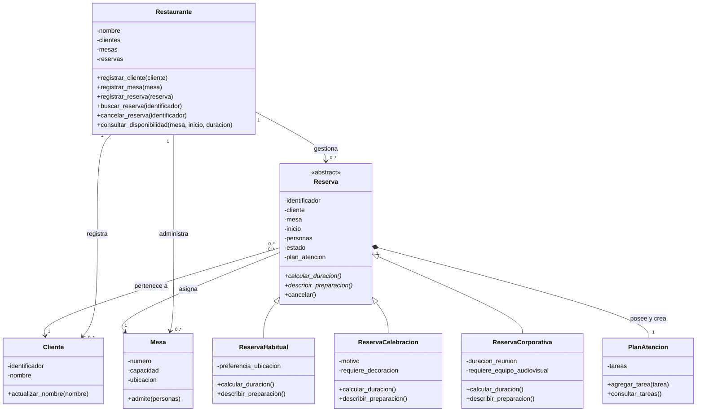

# Diagrama de clases propuesto

Borrador de diseño de la etapa 0. Los métodos y atributos se ajustarán al código real. `-` indica atributos internos y `+` operaciones públicas. Se omiten constructores y propiedades de lectura para facilitar la lectura; se incorporarán los detalles necesarios en la versión final.

Las excepciones propuestas son `MesaNoDisponibleError`, `CapacidadExcedidaError` y `ReservaNoEncontradaError`, derivadas de `Exception`. Se añadirán al diagrama final con sus dependencias cuando estén implementadas.
