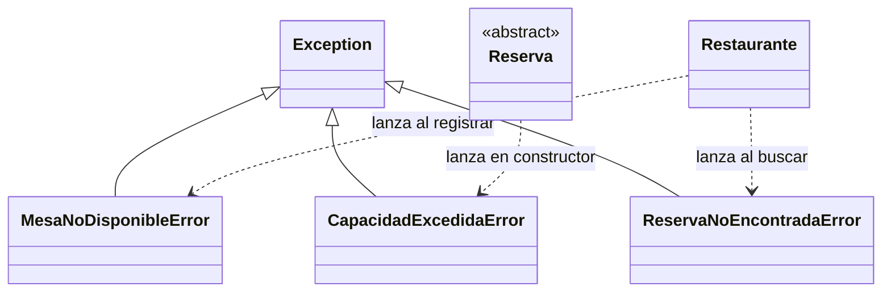

# Diagrama de clases del sistema de reservas

Este diagrama corresponde a las clases implementadas en el paquete restaurante al completar la Parte 5 ampliada. Incluye siete clases concretas del dominio, una abstracta y, en un segundo diagrama, las tres excepciones personalizadas.

`-` indica atributos internos y `+` operaciones públicas; `*` al final de un método indica que es abstracto. El rombo lleno representa composición y la flecha con triángulo representa herencia. Para mantener legible el diagrama, los constructores, las propiedades de lectura y el validador interno se detallan en las tablas posteriores. Los atributos privados se muestran con su nombre conceptual; en el código llevan doble guion bajo.

## Clases del dominio

Cada Reserva se asocia con un Cliente y una Mesa. Estos objetos existen por separado y pueden participar en varias reservas. Cada Reserva crea un único PlanAtencion y no ofrece una operación para reemplazarlo: esta propiedad exclusiva justifica la composición. Cancelar una reserva conserva el plan y no destruye al cliente ni a la mesa.

Restaurante conserva registros de objetos, no crea una copia al registrarlos. El código no impone que un objeto solo pueda registrarse en un restaurante, por lo que la multiplicidad de ese extremo es `0..*`. En el menú se trabaja con un solo restaurante por sesión, mientras la demostración crea uno independiente.

## Constructores y propiedades

Las propiedades indicadas son públicas y no tienen setter. Las referencias a objetos conservan su identidad; las propiedades de colecciones de Restaurante devuelven tuplas de referencias, no copias profundas de las entidades.

| Clase | Argumentos de __init__, sin self | Propiedades de lectura |
| --- | --- | --- |
| Cliente | identificador: str, nombre: str | identificador, nombre |
| Mesa | numero: int, capacidad: int, ubicacion: str | numero, capacidad, ubicacion |
| PlanAtencion | Sin argumentos | No define propiedades; consultar_tareas() devuelve una tupla. |
| Reserva, abstracta | identificador: str, cliente: Cliente, mesa: Mesa, inicio: datetime, personas: int | identificador, cliente, mesa, inicio, personas, estado, plan_atencion |
| ReservaHabitual | Los cinco argumentos de Reserva y preferencia_ubicacion: str | preferencia_ubicacion y las heredadas |
| ReservaCelebracion | Los cinco argumentos de Reserva, motivo: str y requiere_decoracion: bool | motivo, requiere_decoracion y las heredadas |
| ReservaCorporativa | Los cinco argumentos de Reserva, duracion_reunion: int y requiere_equipo_audiovisual: bool | duracion_reunion, requiere_equipo_audiovisual y las heredadas |
| Restaurante | nombre: str | nombre, clientes, mesas, reservas |

Mesa también define el método estático interno `__validar_entero_positivo(valor: int, campo: str) -> None`, reutilizado por su constructor y por admite(). Las excepciones no necesitan constructores propios: heredan el de Exception.

## Tipos de resultado y especialización

| Operación | Resultado |
| --- | --- |
| Cliente.actualizar_nombre(nombre) | None |
| Mesa.admite(personas) | bool |
| PlanAtencion.agregar_tarea(tarea) | None |
| PlanAtencion.consultar_tareas() | tuple de str, instantánea inmutable de las tareas |
| Reserva.cancelar() | None; establece el estado cancelada |
| calcular_duracion(), en cada hija | timedelta positivo |
| describir_preparacion(), en cada hija | str con datos particulares y tareas de su plan |
| Restaurante.registrar_cliente(), registrar_mesa(), registrar_reserva() | None |
| Restaurante.buscar_reserva(identificador) | Reserva concreta registrada |
| Restaurante.cancelar_reserva(identificador) | None |
| Restaurante.consultar_disponibilidad(mesa, inicio, duracion) | bool |

ReservaHabitual calcula 90 minutos; ReservaCelebracion, 120 más 30 si requiere decoración; ReservaCorporativa, los minutos de reunión más 15 si requiere equipo audiovisual. Cada hija sobrescribe los mismos dos métodos de Reserva. La selección de métodos al recorrer los objetos es polimórfica y no necesita condicionales por clase.

## Excepciones y dependencias

El constructor de Reserva lanza CapacidadExcedidaError cuando las personas superan la capacidad. Restaurante.registrar_reserva() lanza MesaNoDisponibleError ante un cruce de horarios; buscar_reserva() lanza ReservaNoEncontradaError si no encuentra el identificador, y cancelar_reserva() reutiliza esa búsqueda.

## Relación con el programa principal

main.py contiene funciones de interfaz, no otra clase de dominio. main() mantiene el menú y el restaurante de la sesión; crear_reserva() selecciona la clase que se construye a partir de la elección del usuario; mostrar_reserva() invoca el contrato común para cualquier tipo de reserva. Las funciones de lectura y selección validan los datos de consola sin acceder a atributos privados.

ejecutar_demostracion() crea los ocho objetos iniciales, los tres planes internos y una lista heterogénea con las tres especializaciones. Un único ciclo invoca calcular_duracion() y describir_preparacion(). La demostración captura las tres excepciones y ejecuta una operación válida después de cada una. Sus registros no se mezclan con los del menú.
